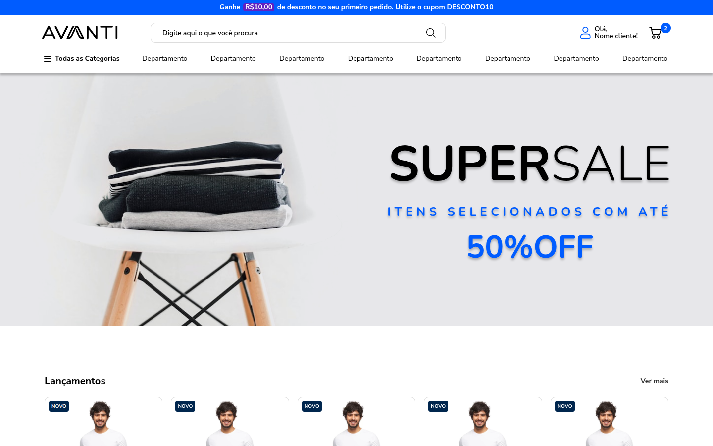
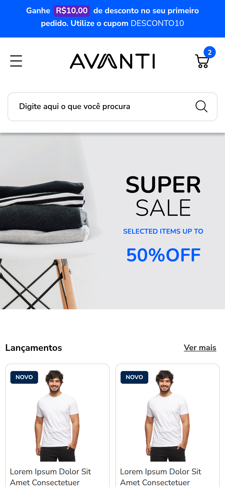

# Desafio 01 – Desenvolvimento do Layout

Projeto desenvolvido para o **Avanti Innovation Challenge – Innovation Class 19**.

Landing page de e-commerce construída com HTML, CSS e JavaScript a partir do layout do Figma, nas versões Desktop e Mobile.

🔗 **Acesse o projeto:** https://lelokz.github.io/Desafio-01-Layout/

| Desktop | Mobile |
|---|---|
|  |  |

## Requisitos

- [x] Estrutura HTML conforme o layout do Figma
- [x] Estilos com CSS
- [x] Layout responsivo (Desktop e Mobile)
- [x] Busca em JavaScript: ao clicar na lupa, exibe `Você buscou por: 'assunto buscado'` abaixo do campo
- [x] Carrosséis interativos (Swiper)

## Funcionalidades

- **Busca:** exibe o termo digitado abaixo do campo ao clicar na lupa ou pressionar Enter.
- **Carrosséis de lançamentos:** 5 produtos por página no desktop e 2 no mobile, com setas, paginação clicável e arraste no touch.
- **Menu de departamentos:** destaque no hover e mega-menu com categorias e banner, também acessível pelo teclado.
- **Menu mobile:** painel lateral aberto pelo botão hambúrguer.
- **Footer mobile:** colunas de links em formato accordion.
- **Newsletter:** validação nativa dos campos e mensagem de confirmação.

## Tecnologias

- HTML5 semântico
- CSS3 (Flexbox, Grid, media queries e variáveis CSS)
- JavaScript (ES6+), sem frameworks
- [Swiper 11](https://swiperjs.com/) para os carrosséis
- Fontes Nunito e Nunito Sans (Google Fonts)

## Estrutura

```
├── index.html
├── css/
│   └── style.css
├── js/
│   └── main.js
├── Assets/
│   ├── icons/            # logos, ícones, redes sociais, pagamentos e selos (SVG exportados do Figma)
│   └── img/              # imagens do layout
├── docs/                 # capturas de tela usadas neste README
├── Referências-desktop/  # telas de referência exportadas do Figma
└── Referências-mobile/
```

## Como executar

Basta abrir o arquivo `index.html` no navegador. Não há etapa de build nem dependências para instalar.

Se preferir um servidor local:

```bash
python3 -m http.server 8000
# acesse http://localhost:8000
```

## Decisões de implementação

- **Fidelidade ao Figma:** cores, fontes, espaçamentos e tamanhos foram extraídos diretamente do arquivo do Figma. Efeitos como o modo de mesclagem da foto do banner, as sombras e o desfoque do banner de contato foram reproduzidos em CSS.
- **Marcações `<h3>`, `<h4>` e `<h5>` do layout:** foram interpretadas como indicação das tags HTML a usar e aplicadas na estrutura, sem exibir o texto da tag na tela.
- **Conteúdo por versão:** textos e imagens que mudam entre desktop e mobile no Figma são exibidos conforme a largura da tela. O segundo carrossel de lançamentos aparece somente no desktop, como no layout.
- **Telas intermediárias:** o Figma define apenas desktop (1920px) e mobile (390px). Entre esses tamanhos o layout se adapta sem rolagem horizontal, testado de 320px a 1920px.
- **Acessibilidade:** textos alternativos nas imagens, rótulos nos campos, navegação por teclado no menu e fechamento de menus com Esc.
